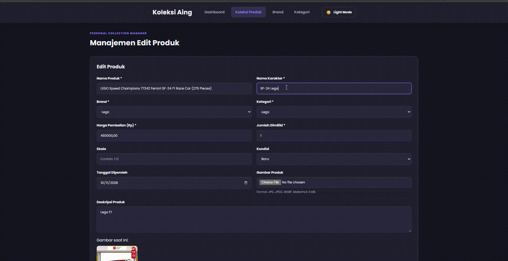

# Janji
Saya Nezhad Ahmad Maliki dengan NIM 2503880 mengerjakan Tugas Praktikum 7 pada Mata Kuliah Desain dan Pemrograman Berorientasi Objek (DPBO) untuk keberkahan-Nya maka saya tidak melakukan kecurangan seperti yang telah dispesifikasikan. Aamiin

# Struktur File

```
C:.
│   index.php
│   style.css
│
├───class
│       Brand.php
│       Database.php
│       Kategori.php
│       Produk.php
│
├───config
│       database.php
│
├───database
│       db_figure.sql
│
├───uploads
│       chopper.jpg
│       ironman.jpeg
│       power.jpg
│
└───view
        brand.php
        dashboard.php
        detail_produk.php
        form_produk.php
        kategori.php
        produk.php
```

# Fungsi program & Alur Program

## Tujuan dibuatnya program Koleksi Aing adalah untuk mengelola data koleksi action figure agar pengguna dapat menyimpan, melihat, menambahkan, mengubah, dan menghapus data koleksi dengan lebih mudah. Program ini memiliki ruang lingkup pengelolaan data koleksi figure, mulai dari nama produk, brand, kategori, jumlah unit, harga, hingga gambar produk.

Program ini dibuat menggunakan PHP dengan konsep Object-Oriented Programming (OOP) dan database MySQL sebagai tempat penyimpanan seluruh data.

### Desain Class
Program ini menggunakan beberapa class yang memiliki tugas masing-masing. Atribut yang bersifat internal dibuat private, sehingga akses dan pengelolaan datanya dilakukan melalui method yang tersedia.
- Class Database: Bertugas untuk mengatur koneksi antara program PHP dengan database MySQL menggunakan PDO.
- Class Brand: Bertugas untuk mengelola data brand figure, seperti menampilkan dan mengolah data brand.
- Class Kategori: Bertugas untuk mengelola data kategori figure.
- Class Produk: Bertugas untuk mengelola data produk figure, seperti menampilkan, mencari, menambahkan, mengubah, menghapus, dan mengambil statistik produk.
Class-class tersebut dipisahkan agar setiap class memiliki tanggung jawab masing-masing dan kode program lebih mudah dikelola.

### Alur Program (Flow Kode), Alur Design

Alur program Koleksi Aing dimulai ketika pengguna membuka website. Pengguna akan diarahkan ke halaman dashboard yang menampilkan ringkasan koleksi, seperti jumlah jenis produk, total unit koleksi, jumlah brand, dan total nilai pembelian. Selain itu, dashboard juga menampilkan beberapa produk terbaru yang tersimpan di dalam database.

Pada bagian navigasi, pengguna dapat berpindah ke beberapa halaman, yaitu dashboard, produk, brand, dan kategori.

Pada halaman produk, pengguna dapat melihat seluruh data koleksi figure yang tersimpan di dalam database. Pengguna juga dapat menambahkan produk baru dengan mengisi informasi yang diperlukan, seperti nama produk, brand, kategori, jumlah unit, harga, dan gambar produk.

Selain menambahkan data, pengguna juga dapat mengubah dan menghapus data produk yang sudah tersimpan. Ketika pengguna memilih salah satu produk, pengguna dapat melihat informasi produk tersebut secara lebih lengkap melalui halaman detail produk. Pengguna juga dapat melakukan perubahan data atau menghapus produk sesuai kebutuhan.

Untuk halaman brand dan kategori, pengguna dapat mengelola data brand dan kategori yang digunakan dalam pengelompokan produk. Data tersebut nantinya berhubungan dengan data produk sehingga informasi koleksi dapat tersusun dengan lebih teratur.

Seluruh proses pengelolaan data dilakukan dengan menghubungkan halaman utama melalui index.php dengan class yang sudah dibuat. Ketika pengguna melakukan suatu tindakan, program akan memproses permintaan tersebut dan menjalankan method yang sesuai. Setelah proses berhasil, data akan diperbarui dan ditampilkan kembali pada halaman website.


### Alur Database dan Konfigurasi
Program ini menggunakan database MySQL dengan nama database db_figure untuk menyimpan seluruh data yang digunakan.

Koneksi database dikelola melalui class Database.php, sedangkan file config/database.php digunakan untuk menginisialisasi koneksi dan objek dari class yang diperlukan, seperti Brand, Kategori, dan Produk.

Dengan cara tersebut, setiap halaman tidak perlu membuat koneksi database secara berulang. Halaman cukup menggunakan objek yang sudah disiapkan melalui file konfigurasi.

### Penjelasan Desain Tampilan Program
Untuk desain tampilan, Koleksi Aing dibuat dalam bentuk website dengan beberapa komponen antarmuka yang memiliki fungsi masing-masing.
- Dashboard digunakan untuk menampilkan ringkasan data koleksi, seperti total jenis produk, total unit, jumlah brand, dan total nilai pembelian.
- Navigasi digunakan untuk berpindah dari satu halaman ke halaman lainnya, seperti dashboard, produk, brand, dan kategori.
- Form input digunakan untuk memasukkan data baru maupun mengubah data yang sudah tersedia.
- Tabel produk digunakan untuk menampilkan daftar produk yang tersimpan di dalam database.
- Halaman detail produk digunakan untuk menampilkan informasi produk secara lebih lengkap, termasuk gambar produk.
- Halaman brand dan kategori digunakan untuk menampilkan serta mengelola data brand dan kategori.

Tampilan website juga menggunakan CSS untuk mengatur warna, ukuran, tata letak, jenis font, dan responsivitas tampilan. Selain itu, terdapat fitur dark mode yang memungkinkan pengguna mengubah tampilan website menjadi tema gelap.

Dengan adanya pembagian halaman dan komponen tersebut, pengguna dapat mengelola koleksi figure melalui tampilan yang lebih terstruktur dan mudah digunakan.

# Dokumentasi

## Input


## Update


## Delete


## Update klo ada yang kosong


## Input klo ada yang sama

